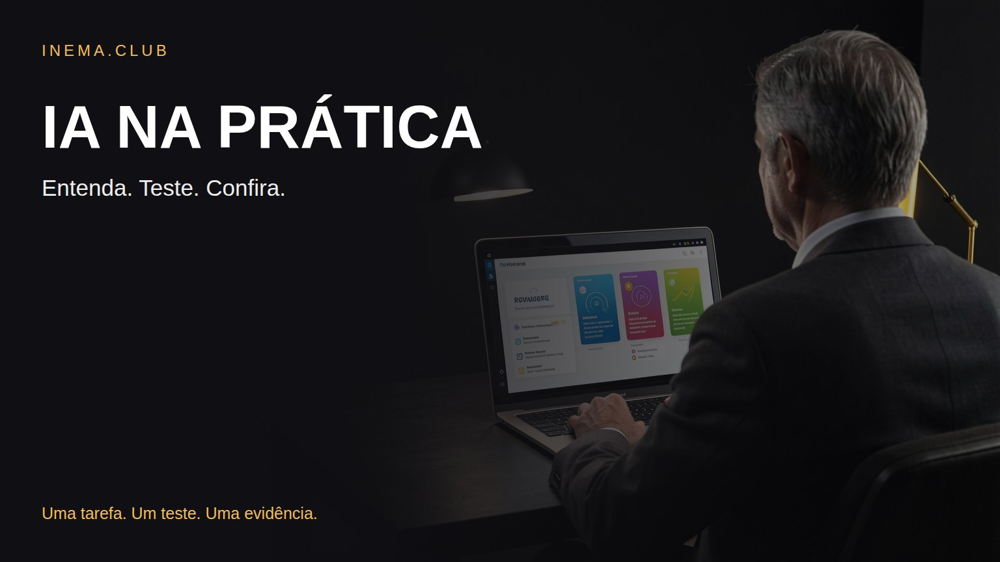

# Roteiro IA na prática

[](https://inematds.github.io/roteiro-ia-pratica/guia/)

**[Português](README.md) · [English](README.en.md) · [Español](README.es.md)**

## O que é

Este é um kit de estudo e prática sobre inteligência artificial para quem quer entender o assunto e aplicar uma primeira melhoria no trabalho. Ele reúne uma análise de vídeo, um glossário e modelos de diagnóstico, pedido e avaliação. Você começa por uma tarefa real e confere o resultado antes de automatizar. Para usar os documentos, basta ler e copiar; o avaliador opcional roda com Python, sem serviços externos.

## Guia de uso

[Guia em português](https://inematds.github.io/roteiro-ia-pratica/guia/).

🎬 Vídeo: https://www.youtube.com/watch?v=dp_MP4qWVZI

## Conhecimento e recursos

- [Análise crítica e aproveitamentos](conhecimento/analise.md)
- [Glossário](conhecimento/glossario.md)
- [Fontes e capítulos](fontes/README.md)
- [Diagnóstico de processo](recursos/diagnostico-de-processo.md)
- [Modelo de prompt](recursos/prompt-de-trabalho.md)
- [Piloto de sete dias](recursos/piloto-sete-dias.md)
- [Brief de piloto](recursos/brief-de-piloto.md)
- [Planilha de avaliação](recursos/avaliacao.csv)
- [Checklist de qualidade](recursos/checklist-de-qualidade.md)

## Avaliação local opcional

Python 3, apenas biblioteca padrão. Preencha a planilha antes de calcular:

```bash
python3 scripts/avaliar.py recursos/avaliacao.csv
python3 -m unittest discover -s tests -v
```

O cálculo inclui revisão e correção; casos incompletos ficam pendentes. Não há chamadas de modelos nem serviços externos.

## Origem e limites

Análise do vídeo [The Last AI Roadmap Video You’ll Ever Watch, de Nick Saraev](https://www.youtube.com/watch?v=KjKlBvX9G7w). Os recursos de prática são autorais e estão identificados como complementos. Não reproduzimos a transcrição integral nem prometemos resultado financeiro.

O guia tem versões PT/EN/ES. Os documentos aprofundados e os recursos estão em português.

## Produção de vídeos

Roteiros e estado em [roteiros](roteiros/) e [tasks/current.md](tasks/current.md). Produção audiovisual e publicações pendentes não devem ser apresentadas como concluídas.

- [Catálogo de recursos citados e complementares](recursos/catalogo-de-estudo.md)

---

Projeto adaptado da comunidade INEMA TDS - Marca Arckhe